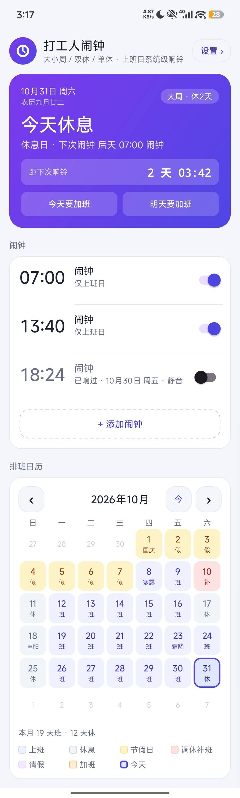
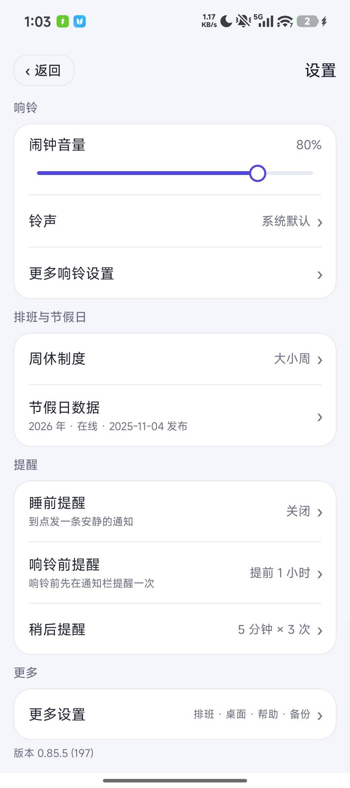
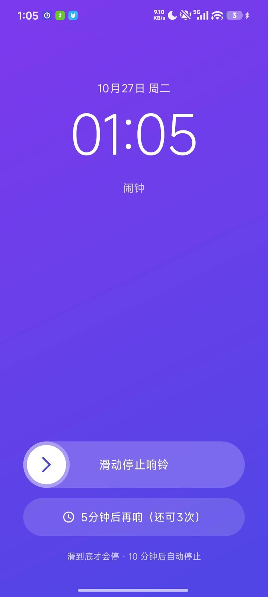
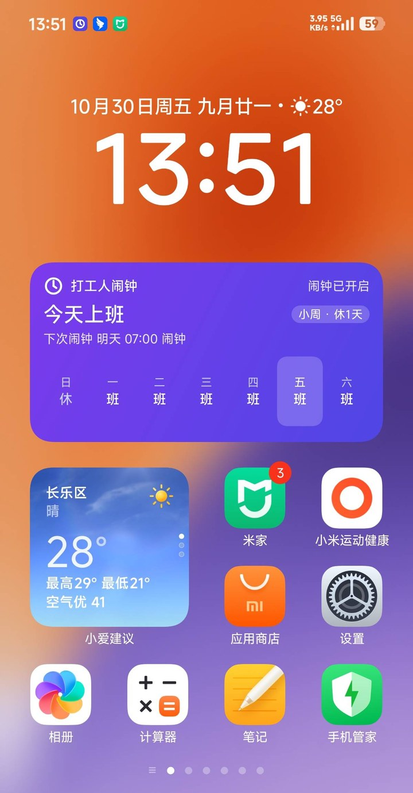
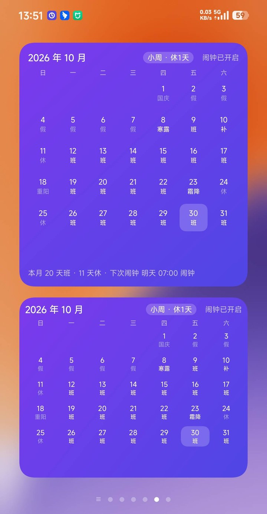
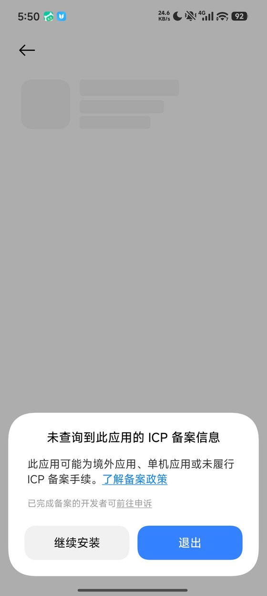

# 打工人闹钟 · Weekday Alarm

*A shift-aware alarm clock for Android — rings only on the days you actually work. [English](#english)*

**按你的周休制度推算上班日，只在上班日响的闹钟。**

双休、单休（周日休 / 周六休）、大小周都支持；法定节假日与调休补班自动算进去。
不管哪种排班，都不用再手动改闹钟。

<p align="center">
  
  
  
</p>

<p align="center"><sub>首页 · 设置 · 响铃</sub></p>

## 功能

- **周休制度推算**：双休 / 单休（周日休、周六休）/ 大小周，设一次就不用管
- **节假日与调休**：内置 2007–2026 年法定节假日数据，可在线增量更新
- **日历标记**：农历节日、二十四节气、基督教节日可开关；请假 / 加班手动标，标了当天不响
- **提醒链路**：睡前提醒（明天要不要早起）→ 响铃前提前提醒 → 响铃 → 稍后提醒，环环可配
- **响铃**：铃声（全局默认 + 每条闹钟可单独指定）、音量（直接就是系统「闹钟」那一档）、渐响；解锁使用时是小悬浮窗，锁屏 / 息屏直接全屏
- **桌面小组件**：4×2 下一个闹钟、本月班表 4×4 / 4×3 极简（见下）
- **备份**：闹钟（含各自的铃声）、排班、请假加班标记，导出一个文件，换机一键恢复
- 深色模式、无账号、无广告、无统计

## 桌面小组件

不点开 App，桌面上就能看见「今天上不上班」和「下次几点响」。

<p align="center">
  
  
</p>

<p align="center"><sub>4×2 今天 / 下次闹钟 · 4×4 本月班表 · 4×3 极简</sub></p>

- **4×2**：今天上不上班、下次几点响、本周七天班休一眼看全
- **4×4 / 4×3**：整月班休格子，农历节日、二十四节气、调休补班都按日历页同一套规则标；4×3 去掉底部统计行，更省桌面高度
- 每格的标签和日历页优先级完全一致（班 / 休 / 假 / 补 / 节气 / 节日），不会同一格两处说法不一样
- 添加路径：长按桌面空白处 → 小部件 → 全部应用 → 最底下的「安卓小部件」→ 打工人闹钟

## 下载

**v1.0.0（2026-10-31）**：[下载 APK](https://github.com/IosephusChen/weekday-alarm/releases/download/v1.0.0/weekday-alarm-1.0.0.apk)
· [Releases 页](https://github.com/IosephusChen/weekday-alarm/releases)

每个版本都建了 tag 与 Release，APK 与 `mapping.txt`（崩溃栈反混淆用）一起放，历史版本都在 Releases 里。
支持 Android 8.0 及以上（API 26），安装包约 2.8 MB。

### 安装时可能看到这个弹窗

<p align="center">
  
</p>

**点「继续安装」即可**，功能不受任何影响。

2023 年起，国产系统（小米 / 华为 / OPPO / vivo）在安装**非应用商店来源**的 APK 时会去查
App 备案库，查不到就弹这个提示——它自己不也说了「可能为境外应用、**单机应用**或未履行备案手续」。
原生 Android 不会弹。本项目单人维护、不收费、不上架，没有做备案；装完照常用。

## 权限说明（全部 12 条，逐条对得上用途）

| 权限 | 用途 |
| --- | --- |
| `POST_NOTIFICATIONS` | 响铃通知、提前提醒、睡前提醒 |
| `INTERNET` | 只有两处，都是只读 GET：节假日数据（holiday-cn 仓库）、版本号（本仓库根的 `version.json`）。不带设备信息，不上传任何数据 |
| `MODIFY_AUDIO_SETTINGS` | 设置页的音量条直接读写系统「闹钟」音量档位（v0.91.0 起）。只改这一路，不碰铃声、通话、媒体 |
| `VIBRATE` | 响铃震动 |
| `WAKE_LOCK` | 响铃期间保持 CPU 唤醒，息屏也能响完 |
| `RECEIVE_BOOT_COMPLETED` | 开机后恢复排程 |
| `FOREGROUND_SERVICE` | 响铃期间以前台服务保活 |
| `FOREGROUND_SERVICE_MEDIA_PLAYBACK` | 前台服务类型：播放铃声（Android 10+ 要求声明） |
| `USE_FULL_SCREEN_INTENT` | 锁屏时直接弹出全屏响铃页 |
| `SYSTEM_ALERT_WINDOW` | 解锁使用时弹出响铃小悬浮窗；MIUI 还需「后台弹出界面」权限配合 |
| `SCHEDULE_EXACT_ALARM` | 精确闹钟（Android 12–13） |
| `USE_EXACT_ALARM` | 精确闹钟（Android 13+，闹钟类应用安装时授予） |

## 免责声明

**本应用通过系统闹钟接口触发提醒，实际能否响铃还取决于系统的后台管理策略、厂商省电设置与权限状态。**
重要场合（考试、航班、面试、就医）请另设一个备用闹钟。

## 隐私

不收集任何个人信息：没有账号、没有统计 SDK、没有广告、没有设备指纹。

只有两个网络请求，都是只读的：

- 从 [holiday-cn](https://github.com/NateScarlet/holiday-cn) 拉节假日数据
- 从本仓库根的 `version.json` 拉版本号，「关于」页用它判断有没有新版

两者都只带一个版本号作 UA 标识，不携带设备信息、位置或使用记录。检查更新 7 天一次，
失败就隔天再试，查到新版也不弹窗。

所有数据（闹钟、班表、请假加班记录、设置）只存在本机，不上传、不同步云端。
卸载或清除数据即永久丢失，换机前请先用「导出配置」存一份。

## 为什么做这个

手机自带的闹钟只能按「星期几」重复。可我的休息日不跟着星期走——这周双休、下周单休，
再加上每年国务院临时发的调休补班，一个都不能漏。

大小周最容易算错：这周的周六要上班，下周的周六就休息。按星期几设，单休那周漏响，
双休那周白响。我因为这个迟到过好几次。

而手动改闹钟这件事，改的时候记得，过两个月就忘了当初为什么这么设。所以我做了这个：
把排班规则设一次，之后的每一天它自己算。节假日和补班自动跟上，请假、加班标一下，
那天就不响。

它不收费、没有广告、没有账号，断网也照响——我只是需要一个不会算错的闹钟。

## 关于

作者：**追寻的风**（[IosephusChen](https://github.com/IosephusChen)）

我不是程序员，没学过编程语言。这个 App 是我用 AI 辅助一行行做出来的：二百九十多次提交、
一万七千多行 Java、八百三十多条自动化测试。工具是 [WorkBuddy](https://www.workbuddy.cn)，
主力模型 DeepSeek-V4.1 Flash；早期试过 Hy4 preview、Hy3、Step-5-Preview、GLM-5.3 Flash、
DeepSeek-V4.0 Pro，后来都停用了。写在这里是因为它会改变你怎么读这个仓库：`docs/` 里那些
逐条记着「为什么这么改」的日志、`AGENTS.md` 里「动代码前先拿许可」这类规矩，都是一个看不懂
代码的人为了管住 AI 而立的。

正因为看不懂代码，每改一处都得先让测试跑一遍，红了就退回去重来——这些测试是我唯一能确认
「没改坏」的办法。

它开源，所以上面的每个数字你都能自己核：代码可以读，测试可以跑，网络请求只有两处
（节假日数据、版本号），都在源码里写着。

我不承诺它没有 bug，也不承诺每个都能修好——手上只有一台小米手机，很多问题出在别人
机器上；代码也只能靠 AI 帮我看。但每一条反馈我都会认真看：能修的修，修不了的说清为什么。

我自己每天用它起床，不会放着不管。

## 项目状态

**定位**：解决自己需求的工具，顺手开源给有同样问题的人。功能以「够用、不出错」为准，
不做国际化（大小周、调休是中文职场的概念），不上应用商店（一个人维护，付不起备案和
每次过审的注意力）。

**关于 PR**：issue 欢迎，PR 也欢迎，但有三个前提——说清你在什么设备上验过、带上测试、
一次只改一件事。重构、引入依赖、大范围格式化、加账号或云同步，这几类不用提。

我不会逐行看代码——看不懂。我看的是「你有没有验过」和「CI 绿不绿」。

**回应节奏**：一个人维护，issue 不定期看，通常一两周内会回。闹钟没响、响了关不掉、
数据丢了这类会优先看；功能建议可能很久才回，或者直接说做不了——不是没看见。

提 bug 请走模板，写清手机型号、系统版本，以及这条闹钟是怎么设的。我只有一台小米手机，
拿不到你的设备，信息不全的话我判断不了。

开发节奏与版本记录见 [`docs/`](docs/)——那是给下一个接手的人（包括未来的自己）看的开发日志，
不是使用文档；使用说明在 `docs/打工人闹钟-使用说明.md`。

## 自己构建

环境：JDK 17、Android SDK（`android-34` + build-tools `34.0.0`）。

```bash
# 单元测试（八百三十多条，Robolectric + JUnit）
./gradlew testDebugUnitTest

# lint
./gradlew lint

# 出包（release 已开 R8 + 资源压缩，约 2.8MB）
./gradlew assembleRelease
```

> **国内网络**：依赖来自 `google()` / `mavenCentral()`，直连通常很慢。在 `~/.gradle/init.gradle`
> 里把镜像加在所有仓库之前即可（不需要改本仓库的任何文件），例如：
>
> ```groovy
> allprojects {
>   buildscript {
>     repositories {
>       maven { url 'https://mirrors.tencent.com/nexus/repository/maven-public/' }
>     }
>   }
> }
> ```
>
> 仓库的 `build.gradle` 不写任何 Maven 镜像：一是作者本机已有全局配置，二是写死镜像会让境外构建
> 多一跳不必要的重试。但 `gradle/wrapper/gradle-wrapper.properties` 里的 `distributionUrl` 指向
> 腾讯镜像——那是首构建要下的 130MB 分发包，国内等不起。境外环境换回
> `https://services.gradle.org/distributions/` 即可，本仓库的 CI 就是每次这么做。

release 包经过 R8 混淆：线上崩溃栈要用 `app/build/outputs/mapping/release/mapping.txt`
反混淆（`retrace`）。规则只保四样兜底（源文件名与行号、自定义 View 构造器、枚举、
Parcelable CREATOR），见 `proguard-rules.pro`。

**签名**：正式版用 RSA 4096 的自签证书（`weekdayalarm-release.jks`，有效期到 2054 年）。
密钥与口令都不在仓库里：

- 仓库根有 `keystore.properties`（已 gitignore）→ 用里面的正式签名；
- 没有这个文件 → 回落 `~/.android/debug.keystore`，照样能构建、能跑测试；
- 两者都没有 → 产出未签名的 release 包，debug 包走 AGP 默认签名。

想自己签：在仓库根建一份 `keystore.properties`，写 `storeFile` / `storePassword` /
`keyAlias` / `keyPassword` 四项即可，不用改 `build.gradle`。
**仓库不包含任何密钥文件，也不需要包含。**

## English

**Weekday Alarm** is an Android alarm clock that knows your work schedule.

Most alarm apps treat "weekday" as Monday–Friday. If you work 6-day weeks, alternate between
5- and 6-day weeks (大小周), or have to show up on a Chinese make-up workday (调休), a plain
weekly alarm is wrong roughly half the time.

This app computes actual workdays from three inputs:

- your schedule pattern (5-day / 6-day / alternating 5–6)
- Chinese public holidays and make-up workdays (fetched online, bundled fallback for 2007–2026)
- your own leave / overtime marks

…and only rings on days you actually work. Bedtime reminder → pre-alarm notice → alarm →
snooze, each configurable. Three home-screen widgets (next alarm, full month, compact month).

**Facts**: single-module Java, no third-party runtime dependencies, no account, no ads,
no analytics, all data stays on device, MIT licensed. Android 8.0+ (API 26).
The only network calls are holiday data and one static version file for the update check.

Built with AI assistance — [WorkBuddy](https://www.workbuddy.cn) driving DeepSeek-V4.1 Flash,
with a few other models tried early on and since dropped. The author doesn't read Java; the
test suite is how every change gets checked. That's why the commit log explains *why* rather
than just *what*.

**Interface is Chinese only** — deliberately. The concepts it models (大小周, 调休补班) don't
translate cleanly into English, and a half-translated UI reads worse than an honest one.

```bash
./gradlew assembleRelease      # JDK 17, Android SDK 34
./gradlew testDebugUnitTest    # ~830 unit tests
```

## License

[MIT](LICENSE)
